

  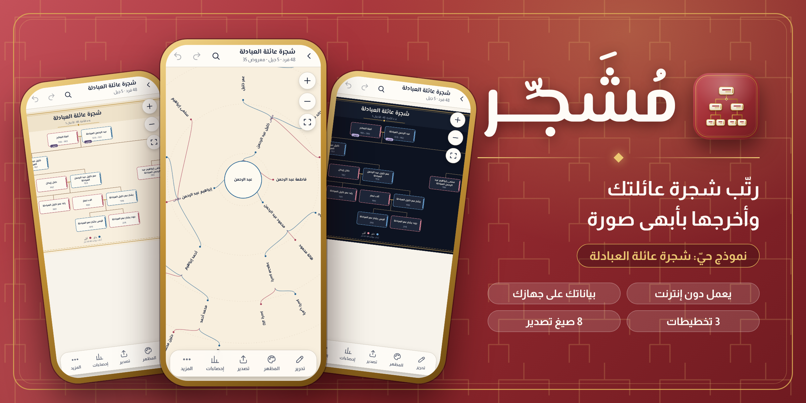

<h3 align="center">ارسم شجرة عائلتك، رتّبها، وأخرجها بأبهى صورة. يعمل دون إنترنت · سريع وخفيف على الجوال.</h3>

  <a href="#المميزات">المميزات</a>
  &nbsp;·&nbsp;
  <a href="#معرض-اللقطات">اللقطات</a>
  &nbsp;·&nbsp;
  <a href="#التثبيت-والبدء">التثبيت</a>
  &nbsp;·&nbsp;
  <a href="#الخصوصية">الخصوصية</a>
  &nbsp;·&nbsp;
  <a href="#عن-صاحب-المشروع">عن المطوّر</a>

---

## ما هو مُشَجِّر؟

**مُشَجِّر** تطبيق عربي بالكامل لبناء شجرة العائلة وعرضها وتصديرها. تفتح ملف العائلة فتظهر الشجرة فوراً بتخطيط أنيق، ثم تُحرّر الأفراد وتبدّل المظهر وتُصدّر النتيجة صورةً أو PDF أو ملف أنساب. كل ذلك على جوالك ودون اتصال بالإنترنت.

يتضمّن التطبيق **بيانات تجريبية كاملة لعائلة العبادلة** (48 فرداً في 5 أجيال، كلها وهمية) لتجرب كل ميزة على شجرة حقيقية الشكل.

 

---

## المميزات

<table>
<tr>
<td width="33%" align="center"> <b>ثلاثة تخطيطات</b> عمودي · أفقي · شعاعي، بتبديل فوري</td>
<td width="33%" align="center"> <b>ثلاث سمات ومظهر قابل للضبط</b> ورق عتيق · ليل · نقي، مع الكثافة والتلوين وشكل الخطوط</td>
<td width="33%" align="center"> <b>دون إنترنت</b> يعمل كاملاً في أي مكان، بلا اتصال ولا حساب</td>
</tr>
<tr>
<td align="center"> <b>8 صيغ تصدير</b> SVG · PNG · PDF · JSON · مشروع · GEDCOM · Excel · CSV</td>
<td align="center"> <b>بحث عربي ذكي</b> يتجاهل التشكيل والهمزات والتاء المربوطة والياء</td>
<td align="center"> <b>تراجع وإعادة</b> 30 خطوة لكل جلسة تحرير</td>
</tr>
<tr>
<td align="center"> <b>لمس طبيعي</b> سحب وقرص وتقريب ونقرة مزدوجة للتحرير</td>
<td align="center"> <b>حفظ تلقائي</b> عملك محفوظ على جهازك أولاً بأول</td>
<td align="center"> <b>يتّسع لعائلات ضخمة</b> انسيابية كاملة مع 4,000 فرد وأكثر، حتى 20,000 فرد</td>
</tr>
<tr>
<td align="center"> <b>خصوصية كاملة</b> بياناتك لا تغادر جهازك أبداً</td>
<td align="center"> <b>56 اختباراً ذاتياً</b> تضمن سلامة التخطيط والتصدير والاستيراد</td>
<td align="center"> <b>مصمَّم للجوال أولاً</b> واجهة بأوراق سفلية وإيماءات وأزرار بحجم مريح</td>
</tr>
<tr>
<td align="center"> <b>علامة «متوفى» ملوّنة</b> كبسولة بلون مميّز على بطاقة كل متوفى، تظهر في الصور المصدَّرة أيضاً</td>
<td align="center"> <b>تنقّل سريع بين الأقارب</b> الأب والزوج والأبناء والإخوة بنقرة، وتحرير شخص بعد آخر دون إغلاق الورقة</td>
<td align="center"> <b>خريطة مصغّرة</b> للأشجار الكبيرة: انقر موضعاً لتقفز إليه فوراً</td>
</tr>
</table>

---

## معرض اللقطات

> كل الصور أدناه **لقطات حيّة من التطبيق نفسه** وهو يعمل على شجرة عائلة العبادلة (والشجرة الكبيرة بيانات تجريبية وهمية).

<table>
<tr>
<td align="center" width="33%">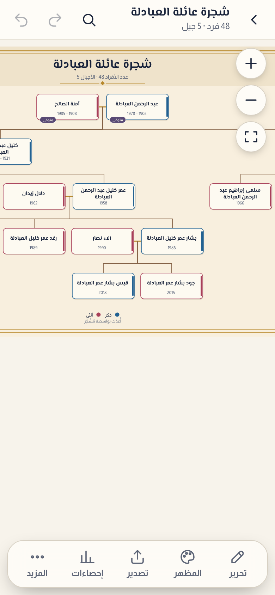 <b>التخطيط العمودي</b> عنوان الشجرة وبطاقات الأفراد بألوان الجنس</td>
<td align="center" width="33%">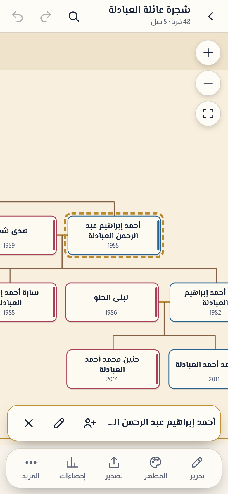 <b>تحديد فرد</b> إطار ذهبي متقطع وشريط إجراءات سريع</td>
<td align="center" width="33%">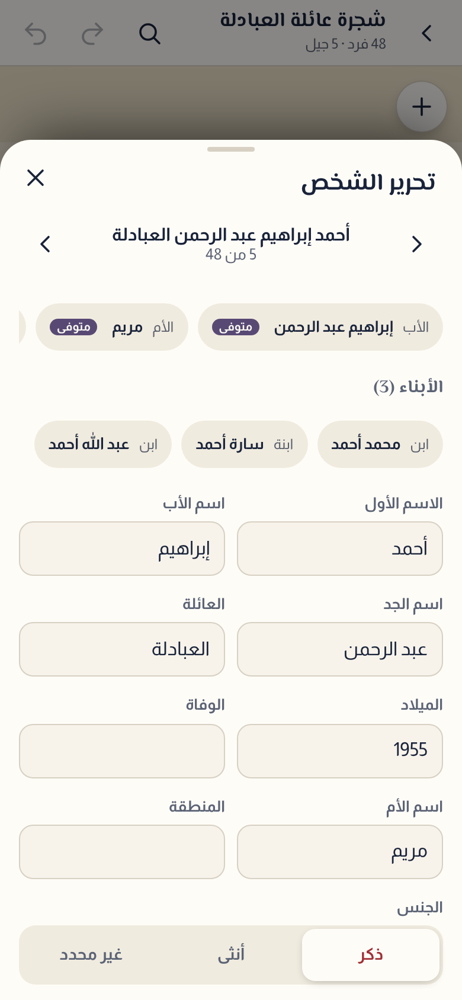 <b>تحرير الفرد</b> ورقة سفلية بحقول الاسم والميلاد والوفاة</td>
</tr>
<tr>
<td align="center">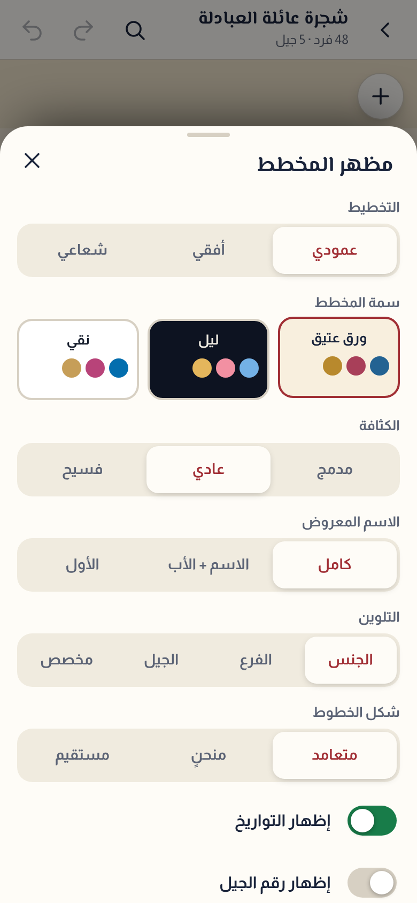 <b>مظهر المخطط</b> التخطيط والسمة والكثافة والتلوين والخطوط</td>
<td align="center">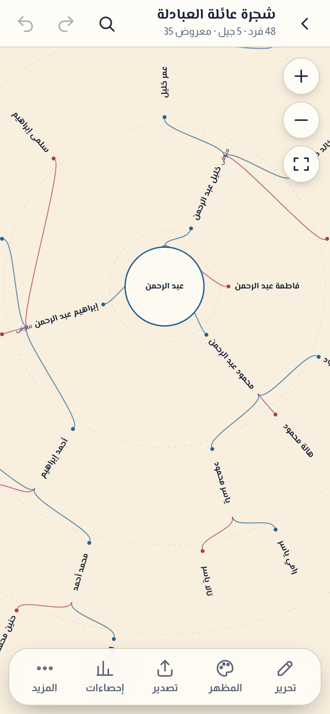 <b>التخطيط الشعاعي</b> الأجداد في المركز والأجيال حلقات</td>
<td align="center">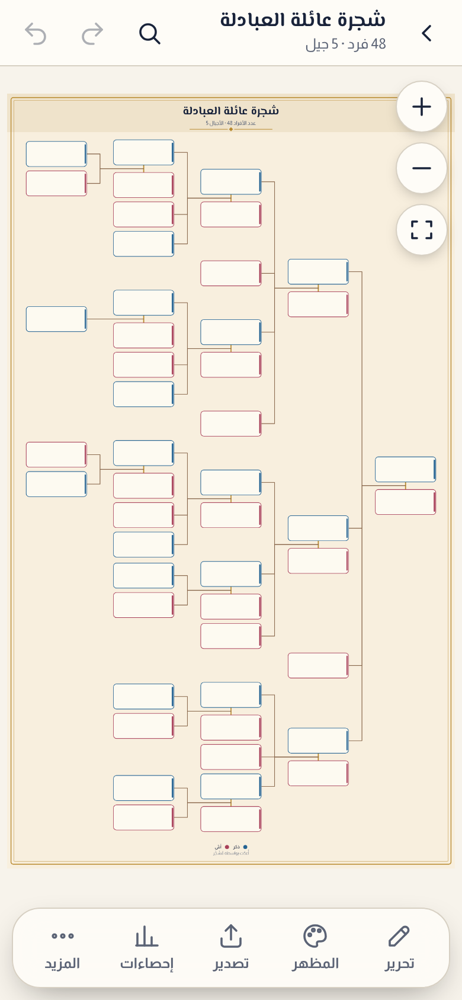 <b>التخطيط الأفقي</b> الشجرة كاملة على شاشة الجوال</td>
</tr>
<tr>
<td align="center">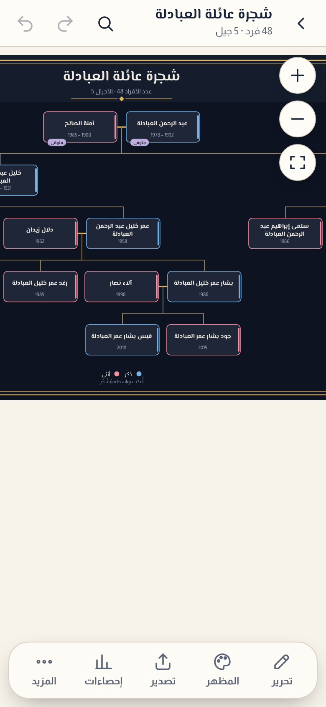 <b>سمة الليل</b> نفس الشجرة بهوية داكنة</td>
<td align="center">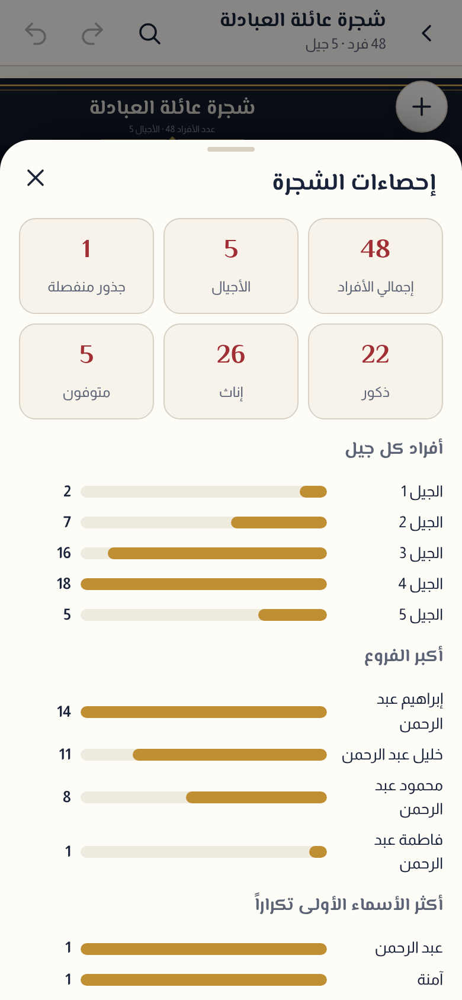 <b>إحصاءات الشجرة</b> الأجيال وأكبر الفروع والأسماء الأكثر تكراراً</td>
<td align="center">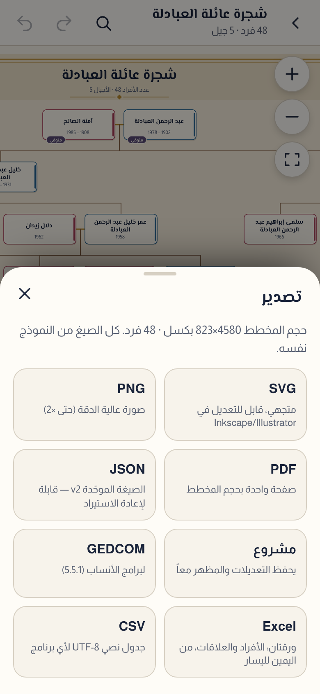 <b>التصدير</b> ثماني صيغ من نموذج واحد</td>
</tr>
<tr>
<td align="center">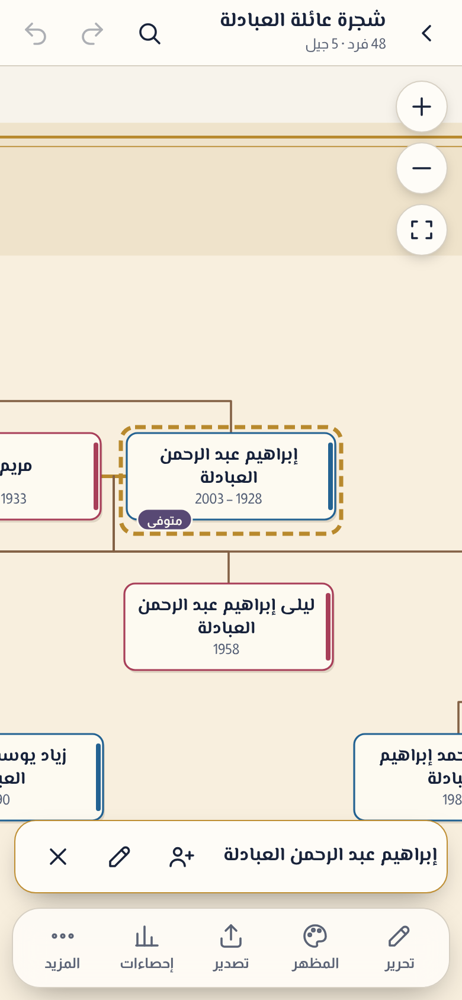 <b>علامة «متوفى»</b> كبسولة بنفسجية على الحافة السفلية لبطاقة المتوفى، بلا تغيير في حجم البطاقة</td>
<td align="center">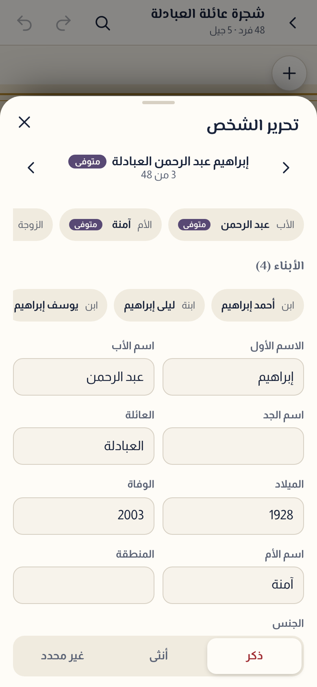 <b>التنقل بين الأقارب</b> الأب والأم والزوج والأبناء بنقرة، وأسهم التالي/السابق للمرور على الجميع</td>
<td align="center">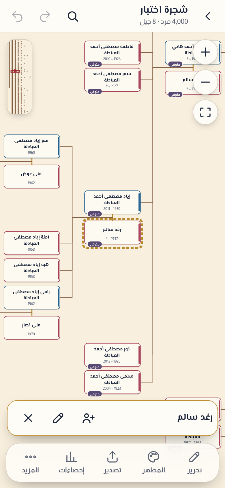 <b>شجرة من 4,000 فرد</b> خريطة مصغّرة أعلى اليمين للقفز بين الفروع، والحركة انسيابية</td>
</tr>
<tr>
<td align="center">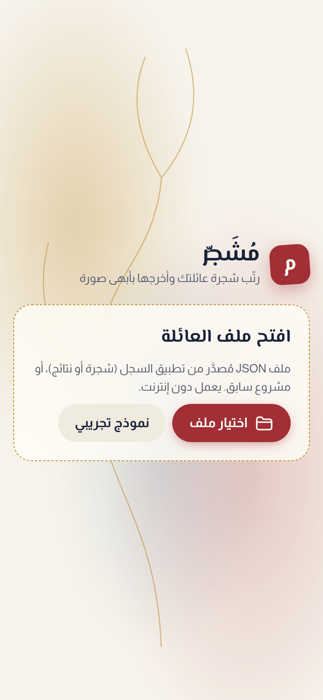 <b>الشاشة الرئيسية</b> خلفية حيّة وأيقونة «م»</td>
<td align="center">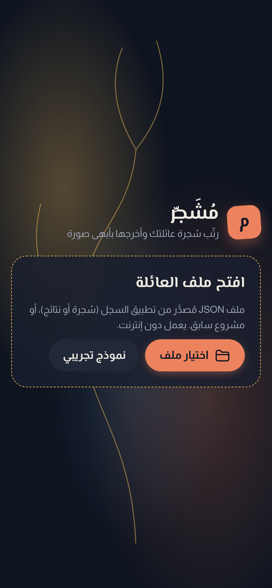 <b>الوضع الداكن تلقائياً</b> يتبع إعداد الجهاز</td>
<td align="center" valign="middle">الألوان تتبدّل بين الفاتح والداكن بسلاسة، وتحافظ على هوية الكريمي والأحمر والذهبي.</td>
</tr>
</table>

### على الشاشات الكبيرة

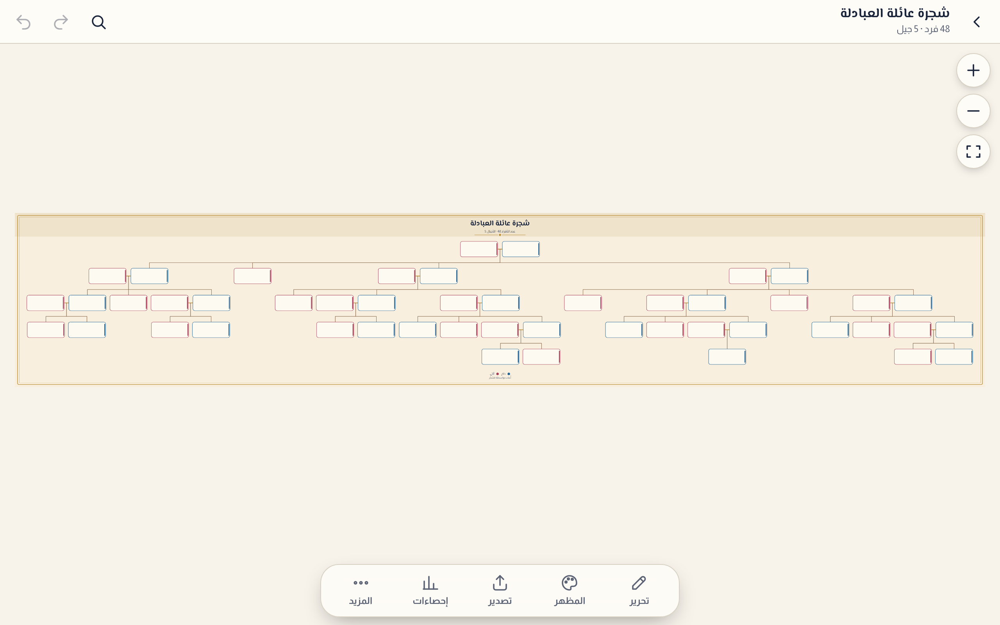

### المخطط المُصدَّر من التطبيق

الصورة التالية **ناتج زر التصدير نفسه** (PNG بدقة ×2) لشجرة عائلة العبادلة كاملة:

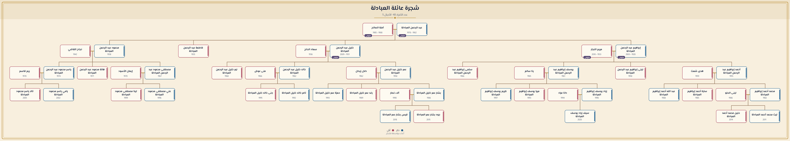

---

## هوية التصميم

التصميم مبنيّ على لون **كريمي (بيج) على أحمر عميق** مع لمسات **ذهبية**؛ وهو لون كل عنصر في التطبيق وأيقونته:

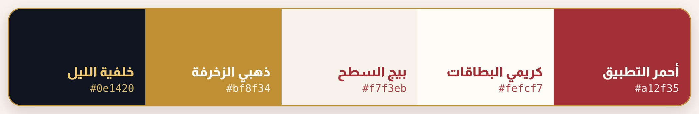

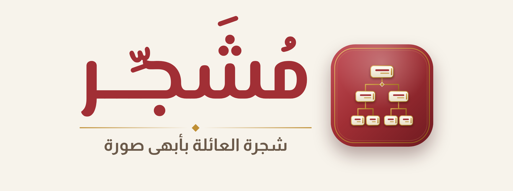

<table>
<tr>
<td align="center" width="40%"> <b>أيقونة التطبيق</b> اسم «مُشَجِّر» بخط عربي فخم تحته شجرة بطاقات ذهبية، على أحمر بحدود ذهبية مزدوجة</td>
<td width="60%"><b>حزمة الهوية</b> في <a href="assets/icons"><code>assets/icons</code></a> و<a href="docs/images"><code>docs/images</code></a>:
<ul>
<li>أيقونة التطبيق بالاسم بأحجام متعددة، ونسخة للقصّ الدائري، ومقدّمة لأيقونة Android التكيّفية</li>
<li>الشعار المركّب بالاسم على خلفية فاتحة وعلى الأحمر</li>
<li>17 أيقونة SVG مرسومة يدوياً بنفس الهوية</li>
</ul>
</td>
</tr>
</table>

---

## بيانات عائلة العبادلة التجريبية

النموذج التجريبي المدمج شجرة **وهمية بالكامل**:

| | |
|---|---|
| إجمالي الأفراد | **48** (35 من العائلة + 13 من الأزواج والزوجات) |
| الأجيال | **5** — من الجد عبد الرحمن إلى الجيل الخامس |
| العلاقات | 81 علاقة (أبوّة وأمومة وزواج) |
| الفروع الكبرى | إبراهيم · خليل · فاطمة · محمود |
| الخصوصية | لا أرقام هويات ولا عناوين ولا ملاحظات شخصية |

---

## التثبيت والبدء

<table>
<tr>
<td width="33%" valign="top"><b>1 — نزّل التطبيق</b> من قسم <b>Releases</b> في هذه الصفحة، نزّل أحدث ملف <code>APK</code>.</td>
<td width="33%" valign="top"><b>2 — ثبّته</b> افتح الملف على جهاز Android واسمح بالتثبيت عند الطلب.</td>
<td width="33%" valign="top"><b>3 — ابدأ</b> اضغط <b>«نموذج تجريبي»</b>، أو اختر ملف عائلتك بزر <b>«اختيار ملف»</b>.</td>
</tr>
</table>

**الاستيراد:** يقبل التطبيق ملف العائلة بصيغة JSON، وملفات «مشروع» التي حفظتها من مُشَجِّر نفسه.

---

## الخصوصية

<table>
<tr>
<td width="12%" align="center"></td>
<td>
<ul>
<li><b>بياناتك لا تغادر جهازك.</b> لا حسابات ولا تتبّع ولا خوادم.</li>
<li><b>الحفظ محلي:</b> ما تبنيه يبقى على جهازك وحده.</li>
<li><b>يعمل دون إنترنت:</b> لا يحتاج اتصالاً لأي ميزة أساسية.</li>
<li><b>استيراد آمن:</b> يتحقق التطبيق من الملفات قبل فتحها، ويضع حدّاً لحجم الملف (25 MB) وعدد الأفراد (20,000).</li>
</ul>
</td>
</tr>
</table>

---

## الأداء والجودة

56 اختباراً ذاتياً تغطي التخطيط والتصدير والاستيراد والأمان والأداء، وكلها ناجحة. المخطط يرسم **ما تراه فقط** وبمستوى تفصيل يتبع التقريب، فتبقى الحركة انسيابية مهما كبرت العائلة. قياسات على شجرة من **4,000 فرد** (8 أجيال) مع معالج أبطأ بأربعة أضعاف لمحاكاة جوال متوسط:

| العملية | الزمن |
|---|---|
| فتح ملف الـ4,000 فرد حتى ظهور المخطط | ≈ 1 ثانية |
| السحب والتقريب والتبعيد | 60 إطاراً/ثانية دون تقطّع |
| تعديل بطاقة وظهورها | ≈ 0.04 ثانية (≈ 0.25 مع معالج أبطأ 4×) |
| التراجع عن تعديل | ≈ 0.04 ثانية |
| الذاكرة المستخدمة | ≈ 15–20 ميغابايت |

وتبقى الحركة سلسة حتى عند 12,000 فرد. خطوات التراجع تحفظ الأشخاص المتغيّرين فقط، والحفظ التلقائي يعمل في وقت الفراغ فلا يقطع التحرير.

---|---|
| قراءة الشجرة وتحليلها | ≈ 8 ms |
| التخطيط العمودي | ≈ 60 ms |
| توليد الرسم المتجهي (SVG) | ≈ 50–80 ms |
| التخطيط الشعاعي | ≈ 40 ms |

---

## سجل الإصدارات

| الإصدار | الجديد |
|---|---|
| **1.2.0** | **أداء** انسيابية كاملة مع 4,000 فرد وأكثر (رسم المنطقة المرئية فقط ومستويات تفصيل) · علامة «متوفى» بلون مميّز على البطاقة · تنقّل سريع بين الأقارب وأسهم لوحة المفاتيح · خريطة مصغّرة للأشجار الكبيرة · اسم العائلة الظاهر في القائمة قابل للتعديل · تخطيط أفقي تلقائي للشجرة الكبيرة |
| **1.1.0** | **إصلاح** عدم استجابة أزرار التقريب والتبعيد والاحتواء للنقر · تحسين العمل دون إنترنت · هوية أيقونات وشعار جديدة |
| **1.0.0** | الإصدار الأول: ثلاثة تخطيطات، ثلاث سمات، ثماني صيغ تصدير، تراجع/إعادة، حفظ تلقائي، 45 اختباراً |

---

## الحقوق

© 2026 ساجد العبادلة — جميع الحقوق محفوظة. لا يُسمح بنسخ المشروع أو تعديله أو إعادة توزيعه دون إذن خطي من صاحبه. كل بيانات عائلة العبادلة في هذا المستودع **وهمية** وُلّدت لأغراض العرض فقط، وأي تشابه مع أشخاص حقيقيين غير مقصود.

---

## عن صاحب المشروع

<table>
<tr>
<td width="20%" align="center"></td>
<td>
<h3>ساجد العبادلة</h3>
<b>GitHub:</b> <a href="https://github.com/Dev-saged"><code>@Dev-saged</code></a>

مطوّر عربي يصنع تطبيقات خفيفة وقوية بفلسفة واضحة: <b>تعمل دون إنترنت، تحترم خصوصية المستخدم، وتُبنى للجوال أولاً.</b>

</td>
</tr>
</table>

صُمّم وبُني بالتعاون مع <b>Claude</b> (Anthropic) · © ساجد العبادلة

